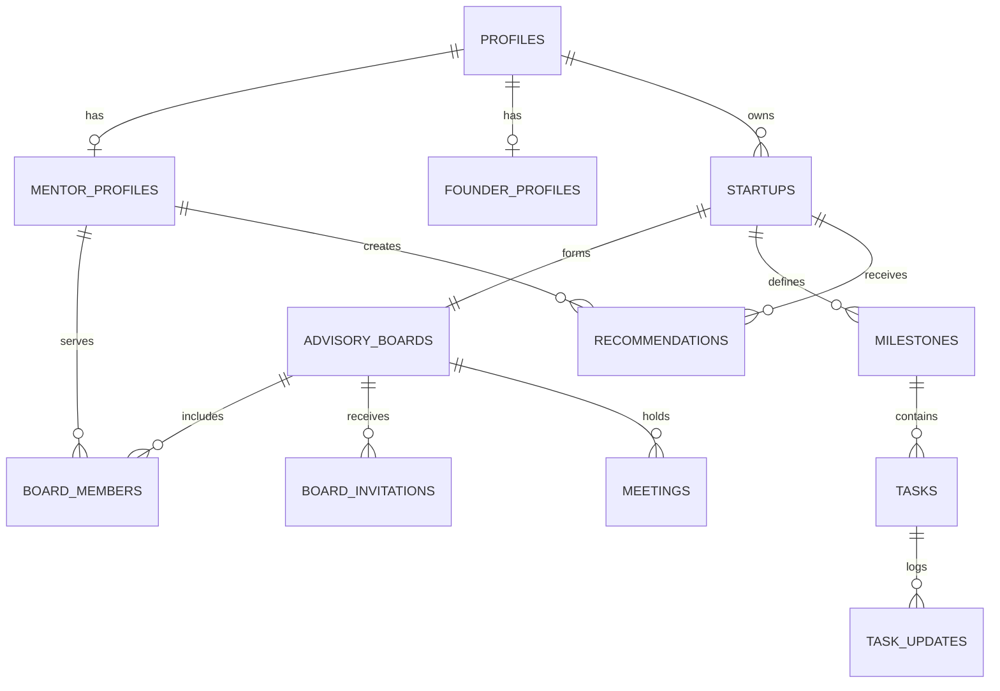

# BusinessBridge

> **Experience meets Ambition.**  
> Connecting experienced retired business leaders with the next generation of entrepreneurs.

---

## 1. Project Overview

BusinessBridge is a full-stack platform built on **Next.js (App Router)** and **Supabase (PostgreSQL + Auth)** designed to bridge the wisdom of veteran business executives with high-potential founders.

The platform is architected around two core modules:
1. **Virtual Boardroom (Module A)**: Founders can assemble retired corporate leaders as advisory board members covering finance, marketing, operations, strategy, and governance.
2. **Business Journey Tracker (Module B)**: Founders and mentors collaboratively set milestones, assign tasks, review progress, and accelerate the startup journey from idea validation to scale.

---

## 2. Technology Stack

- **Framework**: Next.js 15 (App Router, Server Components & Actions)
- **Language**: TypeScript (strict mode enabled)
- **Styling**: Tailwind CSS & CSS design variables
- **Component Primitives**: shadcn/ui & Radix UI
- **Icons**: Lucide React
- **Backend & Database**: Supabase PostgreSQL
- **Authentication & SSR Sessions**: `@supabase/ssr` & `@supabase/supabase-js`
- **Deployment**: Vercel CLI compatible

---

## 3. Project Structure

```text
businessbridge/
├── public/
├── src/
│   ├── app/
│   │   ├── (auth)/
│   │   │   ├── login/page.tsx
│   │   │   └── register/page.tsx
│   │   ├── (founder)/
│   │   │   └── founder/page.tsx
│   │   ├── (mentor)/
│   │   │   └── mentor/page.tsx
│   │   ├── admin/
│   │   │   └── page.tsx
│   │   ├── globals.css
│   │   ├── layout.tsx
│   │   └── page.tsx
│   ├── components/
│   │   ├── layout/
│   │   │   ├── footer.tsx
│   │   │   └── header.tsx
│   │   ├── shared/
│   │   └── ui/
│   │       ├── avatar.tsx
│   │       ├── badge.tsx
│   │       ├── button.tsx
│   │       ├── card.tsx
│   │       ├── dialog.tsx
│   │       ├── dropdown-menu.tsx
│   │       ├── input.tsx
│   │       └── separator.tsx
│   ├── config/
│   │   └── site.ts
│   ├── features/
│   │   ├── authentication/
│   │   ├── journey-tracker/
│   │   └── virtual-boardroom/
│   ├── lib/
│   │   ├── supabase/
│   │   │   ├── check-connection.ts
│   │   │   ├── client.ts
│   │   │   └── server.ts
│   │   ├── utils.ts
│   │   └── validations/
│   │       └── env.ts
│   ├── middleware.ts
│   └── types/
│       ├── auth.ts
│       ├── database.ts
│       ├── founder.ts
│       ├── mentor.ts
│       └── startup.ts
├── supabase/
│   ├── migrations/
│   │   └── 20260217000001_initial_schema.sql
│   └── seed.sql
├── .env.example
├── .gitignore
├── components.json
├── next.config.ts
├── package.json
├── postcss.config.mjs
├── tailwind.config.ts
├── tsconfig.json
└── README.md
```

---

## 4. Database Architecture & Relationships

The database schema (`supabase/migrations/20260217000001_initial_schema.sql`) implements 12 relational PostgreSQL tables with UUID primary keys, foreign key constraints, cascading deletions where appropriate, and Row Level Security (RLS):



### Key Tables & Roles
1. `profiles`: Root user record connected to `auth.users(id)`. Stores full name, email, avatar, and role (`founder`, `mentor`, `admin`).
2. `mentor_profiles`: Executive profiles storing company history, years of experience, domain expertise arrays, biography, and verification status (`pending`, `verified`, `rejected`).
3. `founder_profiles`: Startup founder details including previous experience level and entrepreneurial focus areas.
4. `startups`: Registered ventures belonging to founders with stage tracking (`idea`, `prototype`, `early_traction`, `growth`, `scaling`).
5. `advisory_boards`: The hub for the **Virtual Boardroom** for each startup.
6. `board_members`: Relational junction connecting verified mentors to advisory boards with specific advisory roles.
7. `board_invitations`: Formal invitations sent to mentors by founders.
8. `milestones`: The high-level objectives in the **Business Journey Tracker**.
9. `tasks`: Granular action items under milestones, assignable to founders or mentors.
10. `task_updates`: Audit log of progress updates and percentage completion (0-100%).
11. `meetings`: Board meeting agendas, dates, and recorded minutes.
12. `recommendations`: Strategic advisory recommendations submitted by mentors.

---

## 5. Environment Variables & Setup

Copy `.env.example` to `.env.local`:

```bash
cp .env.example .env.local
```

Fill in your project credentials from the [Supabase Dashboard](https://supabase.com/dashboard/project/_/settings/api):

```env
# Public Supabase credentials
NEXT_PUBLIC_SUPABASE_URL=https://your-project-id.supabase.co
NEXT_PUBLIC_SUPABASE_ANON_KEY=your-supabase-anon-key

# Server-side Service Role key (Keep confidential, never commit!)
SUPABASE_SERVICE_ROLE_KEY=your-supabase-service-role-key
```

---

## 6. Development Workflow

### Install Dependencies
```bash
npm install
```

### Start Development Server
```bash
npm run dev
```
Open [http://localhost:3000](http://localhost:3000) to view the application.

### Run Production Build & Lint Checks
```bash
npm run lint
npm run build
```

### Supabase CLI Commands
```bash
# Push database migrations to linked Supabase project
npx supabase db push

# Apply seed data
npx supabase db reset
```

---

## 7. Multi-Developer Team Workflows (Phase 02 Ready)

The architecture is cleanly decoupled into feature modules:
- **Developer A (Auth & Admin)**: Works in `src/features/authentication/`, `src/app/(auth)/`, and `src/app/admin/`.
- **Developer B (Virtual Boardroom)**: Works in `src/features/virtual-boardroom/`, `advisory_boards`, `board_members`, and `meetings`.
- **Developer C (Business Journey Tracker)**: Works in `src/features/journey-tracker/`, `milestones`, `tasks`, and `task_updates`.
